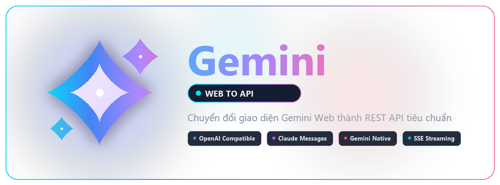
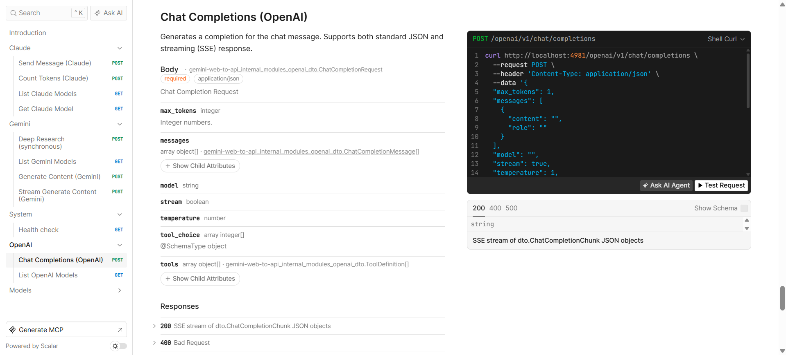

<p align="center">
  
</p>

<p align="center">
  <a href="https://github.com/ntthanh2603/gemini-web-to-api/releases"></a>
  <a href="https://golang.org/"></a>
  <a href="https://www.docker.com/"></a>
  <a href="https://github.com/ntthanh2603/gemini-web-to-api/pkgs/container/gemini-web-to-api"></a>
  <a href="https://github.com/ntthanh2603/gemini-web-to-api/blob/main/LICENSE"></a>
  
</p>

<p align="center">
  <a href="https://github.com/ntthanh2603/gemini-web-to-api/stargazers"></a>
  <a href="https://github.com/ntthanh2603/gemini-web-to-api/issues"></a>
  
</p>

<p align="center">
  <a href="README.md">🇻🇳 Tiếng Việt</a> | <a href="README_en.md">🇬🇧 English</a>
</p>

<h1 align="center">Gemini Web To API</h1>

<p align="center">
  Transforms Google Gemini web interface into a standardized REST API.<br/>
  Access Gemini's power without API keys, using your browser cookies.
</p>

<p align="center">
  <b>Created by <a href="https://github.com/ntthanh2603">@ntthanh2603</a></b>
</p>

> [!NOTE]
> This project is intended for **research and educational purposes only**. Please use responsibly and refrain from any commercial use.

> [!WARNING]
> This project is not affiliated with Google. It uses reverse-engineered web cookies and may not comply with [Google's Terms of Service](https://policies.google.com/terms). Use at your own risk. The author assumes no responsibility for any account actions or data loss.

---

## Overview

Gemini Web To API creates a local proxy server that connects to Google Gemini's web interface using session cookies from your browser, exposing compatible endpoints for OpenAI, Claude, and Gemini SDKs.

- Connects to Gemini's web interface using your browser cookies
- Exposes OpenAI, Claude, and Gemini-compatible API endpoints
- Requires no official API keys
- Handles session tokens and background cookie rotation

---

## Quick Start

### Option A: Docker Run (no build required)

Pull and run directly from GitHub Container Registry.

#### 1. Retrieve session cookies

> [!WARNING]
> Keep cookie values private. Never share or commit them, as they grant direct access to your Google account.

1. Sign in to [gemini.google.com](https://gemini.google.com) in your browser.
2. Open Developer Tools (`F12`), go to the **Network** tab, reload the page, and select any `batchexecute?rpcids=otAQ7b` request.
3. Copy the full `Cookie` request header. If the URL contains an account identifier such as `/u/2/`, note `2` for `GEMINI_AUTH_USER`.

#### 2. Start the container

```bash
docker run -d -p 4981:4981 \
  -e GEMINI_COOKIES="your_complete_cookie_header" \
  -e GEMINI_AUTH_USER="2" \
  -e GEMINI_REFRESH_INTERVAL=1440 \
  -e GEMINI_MAX_RETRIES=3 \
  -e GEMINI_TEMPORARY=false \
  -e APP_ENV=production \
  -e RATE_LIMIT_ENABLED=true \
  -e RATE_LIMIT_WINDOW_MS=60000 \
  -e RATE_LIMIT_MAX_REQUESTS=10 \
  -v ./cookies:/home/appuser/.cookies \
  --tmpfs /tmp:rw,size=512m \
  --tmpfs /home/appuser/.cache:rw,size=256m \
  --name gemini-web-to-api \
  --restart unless-stopped \
  ghcr.io/ntthanh2603/gemini-web-to-api:latest
```

Proceed to [Verification](#verification).

---

### Option B: Build from source

Use this method to modify source code or compile for specific architectures.

#### 1. Clone repository

```bash
git clone https://github.com/ntthanh2603/gemini-web-to-api.git
cd gemini-web-to-api
```

#### 2. Configure environment

> [!WARNING]
> Never commit `.env` containing sensitive cookie values to version control.

1. Sign in to [gemini.google.com](https://gemini.google.com).
2. Open `F12` -> **Network**, reload, and find a `batchexecute?rpcids=otAQ7b` request.
3. Copy the `Cookie` request header into `GEMINI_COOKIES`.
4. If the URL contains `/u/<number>/`, set `GEMINI_AUTH_USER` to that number. Otherwise, leave it empty.
5. Create your configuration file:

   ```bash
   cp .env.example .env
   ```

6. Fill in your configuration values:

   ```env
   GEMINI_COOKIES=your_complete_cookie_header
   GEMINI_AUTH_USER=2
   GEMINI_REFRESH_INTERVAL=1440
   GEMINI_MAX_RETRIES=3
   GEMINI_TEMPORARY=false
   APP_ENV=production
   RATE_LIMIT_ENABLED=true
   RATE_LIMIT_WINDOW_MS=60000
   RATE_LIMIT_MAX_REQUESTS=10
   ```

#### 3. Start the server

| Method | Command | Requirements |
| --- | --- | --- |
| Docker Compose | `docker compose up -d --build` | Docker |
| Go direct | `go run cmd/server/main.go` | [Go 1.21+](https://golang.org/dl/) |
| Task (Development) | `task dev` | [Task](https://taskfile.dev) + [Air](https://github.com/air-verse/air) (`task install-air`) |

`task dev` enables live reload through Air, watching `.go`, `.json`, and `.env` files.

---

### Verification

Send a test request with curl:

```bash
curl -X POST http://localhost:4981/openai/v1/chat/completions \
  -H "Content-Type: application/json" \
  -d '{"model": "gemini-advanced", "messages": [{"role": "user", "content": "Hello!"}]}'
```

The service listens on `http://localhost:4981`.

---

## Features

- Protocol support: OpenAI (`/openai/v1`), Claude (`/claude`), and Gemini (`/gemini/v1beta`) endpoints
- Drop-in SDK compatibility: works with standard OpenAI, Anthropic, and Google GenAI clients
- Session maintenance: periodically rotates cookies to prevent token expiration
- Architecture: built with Go and Fiber
- Deployment: Docker Compose, health checks, and interactive Scalar UI at `/docs`
- Image generation: OpenAI-compatible text-to-image with authenticated `b64_json` output
- Image inputs: handles remote URLs, `data:` URLs, and multi-image references in chat requests
- Video generation: text-to-video (16:9 and 9:16 MP4) via Gemini Web Videos tool
- Canvas mode: supports Gemini Canvas documents via `-canvas` model IDs (e.g. `gemini-pro-canvas`)
- Music generation: audio output via `client.audio.speech` and `-music` model aliases

Refer to technical guides for details:
- [Image generation and image inputs](docs/image-generation.md)
- [Video generation](docs/video-generation.md)
- [Canvas mode](docs/canvas.md)
- [Music generation](docs/music.md)

---

## Configuration

### Environment variables

| Variable | Required | Default | Description |
| --- | --- | --- | --- |
| `GEMINI_COOKIES` | Yes | — | Complete Cookie request header from Gemini Web session |
| `GEMINI_AUTH_USER` | No | — | Google account index from Gemini URL (e.g., `2` for `/u/2/`) |
| `GEMINI_REFRESH_INTERVAL` | No | `1440` | Cookie rotation frequency in minutes (minimum `10`) |
| `GEMINI_MAX_RETRIES` | No | `3` | Maximum retry attempts for failed backend requests |
| `GEMINI_TEMPORARY` | No | `false` | Enable stateless incognito mode for all requests |
| `PORT` | No | `4981` | Server listening port |
| `RATE_LIMIT_ENABLED` | No | `false` | Enable in-memory rate limiting |
| `RATE_LIMIT_WINDOW_MS` | No | `60000` | Rate limit evaluation window in milliseconds |
| `RATE_LIMIT_MAX_REQUESTS` | No | `10` | Maximum allowed requests per time window |

### Rate limiting and rotation notes

The server rotates the `__Secure-1PSIDTS` cookie and refreshes the session token to maintain connectivity. Excessive rotation frequency can trigger automated traffic detection, resulting in HTTP 429 status codes or forced re-authentication.

- The default interval is 1440 minutes (24 hours). Values under 10 minutes are raised to 10.
- If rate limits occur, keep the default interval and enable `RATE_LIMIT_ENABLED=true` with a conservative request threshold.
- If sessions expire prematurely (`marking client unhealthy` in logs), check cookie validity and generate fresh browser credentials.

### Configuration precedence

1. Environment variables (highest)
2. `.env` file
3. Default values (lowest)

---

## Usage Examples

### Dynamic model discovery

The proxy discovers available models directly from the signed-in Gemini Web account:

```bash
curl http://localhost:4981/openai/v1/models
```

Model IDs reflect Gemini's current interface identifiers (such as `gemini-3.6-flash` and `gemini-3.1-pro`). Unlisted models return an explicit error. When Google updates or deprecates models, they appear directly in the output without requiring proxy code changes. `gemini-advanced` is retained as an alias for the Pro tier.

If account quota for a higher tier is temporarily exhausted, Gemini Web may respond using a fallback model. When detected, the proxy reports the actual serving model in the `model` response field, while keeping the original request value in `requested_model`.

### Python OpenAI SDK

```python
from openai import OpenAI

client = OpenAI(
    base_url="http://localhost:4981/openai/v1",
    api_key="not-needed"
)

response = client.chat.completions.create(
    model="gemini-advanced",
    messages=[{"role": "user", "content": "Hello!"}]
)
print(response.choices[0].message.content)
```

### Python Claude SDK (LangChain)

```python
from langchain_anthropic import ChatAnthropic

llm = ChatAnthropic(
    base_url="http://localhost:4981/claude",
    model="gemini-advanced",
    api_key="not-needed"
)

response = llm.invoke("Explain quantum computing")
print(response.content)
```

### Python Google GenAI SDK

```python
from google import genai

client = genai.Client(
    api_key="not-needed",
    http_options={
        "base_url": "http://localhost:4981/gemini",
        "api_version": "v1beta",
    },
)

response = client.models.generate_content(
    model="gemini-advanced",
    contents="Write a poem about coding",
)
print(response.text)
```

Install the official client via `pip install google-genai`. Streaming responses are supported through `generate_content_stream`.

### cURL

```bash
curl -X POST http://localhost:4981/openai/v1/chat/completions \
  -H "Content-Type: application/json" \
  -d '{
    "model": "gemini-advanced",
    "messages": [{"role": "user", "content": "What is AI?"}],
    "stream": false
  }'
```

Additional scripts are located in the [`examples/`](examples/) directory.

---

## API Documentation

Interactive API documentation is accessible at `http://localhost:4981/docs` through the Scalar UI engine.



---

## Contributing

Pull requests and issues are welcome.

1. Fork the repository
2. Create a feature branch (`git checkout -b feature/improvement`)
3. Commit changes (`git commit -m 'Add improvement'`)
4. Push to branch (`git push origin feature/improvement`)
5. Open a Pull Request

---

## Author

- **Nguyễn Tuấn Thành** ([@ntthanh2603](https://github.com/ntthanh2603))

---

## License

This project is licensed under the MIT License. See [LICENSE](LICENSE) for details.
